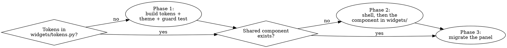

# GUI Design for the XKNX Editor

## The current UI is not the reference

The existing look is the **starting point of an overhaul, not a model to copy.**
Do not derive spacing, colors, sizes or layout from neighbouring code. Derive
them from the target design in this skill. Known weaknesses of the current UI:

- It imitates Windows dialogs/WPF on top of stock hello_imgui themes
  (`microsoft_style`, `darcula_darker`). Nothing in it is a deliberate visual language.
- There is no token layer. About 64 `ImVec4(...)` literals and 85
  `push_style_color` calls are scattered across panels, and the Bus Diagram and
  Timeline each keep their own palette.
- There is one font size (14 px), plus `heading()` at ×1.35. There is no type
  scale, so hierarchy is carried by boxes and separators.
- Button rows are built from bare `imgui.button` + `same_line()` (more than 200 calls).
  The rows do not wrap and have no clear primary action.
- Information hides in hover tooltips. Touch users never see it.
- Visual quality was never verified by looking at it. There is no screenshot tooling.

Use the current code only to learn the **technical** building blocks
(`px()`, `begin_dialog`, `begin_data_table`, `same_line_if_fits`, `filter_box`, …).
These blocks may be restyled or replaced as well.

## The reference: spec and prototype

- **Spec:** `docs/superpowers/specs/2026-11-24-gui-redesign-design.md` (the why).
- **Prototype:** open `docs/design/prototype/index.html` (double-click, works from `file://`;
  `?fast=1` shortens simulations). It is the **visual reference**: when it and this skill
  disagree, the prototype wins; fix the skill in the same change. `tokens.css` mirrors
  design-system.md; `app.css` shows the components.md patterns. Its German demo texts are
  not msgids; the program's texts follow AGENTS.md.

## Target design: workspaces and the shell

Settled by the redesign (details and drawings in [components.md](components.md)):

1. **Workspaces per use case.** Planning, Commissioning, Diagnostics & Service, Handover,
   plus user-saved ones. A workspace decides which views the sidebar lists, what the list
   column shows and which action is primary. It is a saved layout, not a mode.
2. **Shell = top bar + view sidebar + list + editor tabs.** The top bar holds the workspace
   switcher, ⌘K search and the connection status pill. The sidebar collapses to icons.
   A single click in the list opens a **preview tab** (italic, replaced by the next click);
   double-click, Enter or the first edit keeps it. "Detail" is the active tab, not a panel.
3. **Flat structure.** At most **one toggle** under the editor header ("Parameters | Group
   Objects"); no tabs inside tabs. Pages go into a page list. A filter such as "All | Changed (n)"
   sits in the content's toolbar row and is not a toggle.
4. **Overview + detail** (provisional rule). List rows hold text, compact symbols and
   badges, never input fields (toolbars above a list may hold inputs). Click selects, double-click/Enter opens, a multi-selection
   is edited in the detail or the inspector. Rename in the detail or with F2.
5. **No locks.** Editing works in every workspace. Safety comes from rule 4 and from
   workspaces that do not put editors up front.
6. **Hide, don't shrink.** Information the workspace does not need is hidden (one step
   away: tab, ⌘K, sidebar), never squeezed into smaller type or tighter rows.
7. **Narrow:** ≥ 1 000 full shell; 600–999 icon rail, list as drawer, inspector as sheet;
   < 600 a drill-down stack (sidebar → list → editor) with a back button.

## Density: hybrid by context

A pro tool used for hours on large projects, but also by newcomers, on tablets and in
the browser. So the density depends on the surface:

| Surface type | Examples | Density | Character |
|---|---|---|---|
| **Work surface** | Topology, Group Addresses, Buildings, Parameters, Group Objects, Monitor, Logger, Timeline, Cockpit, Health, History, Catalog table | **Compact** | Calm and neutral, like VS Code / JetBrains. Content first, little chrome, no boxes inside boxes. Color only for state. |
| **Guided surface** | Welcome, empty states, Recover wizard, connection setup, import/export/sign flows, Settings, every modal dialog | **Comfortable** | Airy and friendly: more whitespace, larger targets, one clear primary action, short explanatory sentences. |
| **Touch** (`web.touch_used()`) | any surface | **Comfortable**, always | 44 px minimum target. No hover-only paths. |

Principles, in priority order:

1. **Hierarchy by typography and space, not by borders.** Use the type scale
   and the spacing scale first, a subtle divider second, and a box only last.
2. **Neutral by default.** About 90 % of the pixels are neutral surfaces and text.
   The accent color marks the primary action, the selection and the focus.
   Status colors mark status, and only status.
3. **Never color alone.** A status always has an icon and/or a word as well
   (color blindness, both themes).
4. **One primary action per view.** The others are secondary or quiet buttons, or
   live in a menu.
5. **Every state is designed.** Default, hover, active, focused, selected,
   disabled, empty, loading, error and "many items" (1 000+ rows).
6. **Consistency beats local cleverness.** If a pattern is missing, add it
   to the shared widgets. Never inline it in one panel.

## Workflow: design system first

**If `widgets/tokens.py` does not exist yet** and the user asks for a panel
redesign: propose Phase 1 as its own change and **ask the user**. Only the user can
approve piloting one panel together with Phase 1. Never bridge the gap with local
constants or helpers in the panel.

**Phase 1 — Tokens and theme** (once, before any panel work):
build the token module and the custom light/dark theme exactly as specified in
[design-system.md](design-system.md). Do this in its own change, and add the guard test
it describes. Also add the screenshot command (see *Verification*).

**Phase 2 — Shell and components:** first the shell (top bar, view sidebar, list
column, editor tabs with preview tabs, workspaces as saved hello_imgui layouts), then each
pattern of [components.md](components.md) as a shared widget under `src/editor_gui/widgets/`
before a panel uses it. components.md is the target, not an inventory: most patterns do not
exist yet. Each widget gets a headless imgui test. Draw-list painting is fine **inside `widgets/`**.

**Phase 3 — Panels:** migrate one panel (or one plugin) per change. Do not
mix a redesign with feature or behaviour changes.

Before you touch a panel, write this design note into the PR description or
the plan, in this order:

1. **Surface type and workspace:** work, guided or both (so the density), and
   which workspaces list the view and what they hide.
2. **User task:** the 1–3 things a user comes to this panel for.
3. **Hierarchy:** what is primary, secondary and tertiary information, and which
   type style and color role each level gets.
4. **Primary action** and where it sits.
5. **States:** how empty, loading, error, disabled, selected and many-rows look.
6. **Narrow and touch:** the layout below 1 000 units (`form_factor()`), and
   the click/long-press path for everything that hover or a shortcut does.
7. **Tokens and components** used, plus any new ones this change adds.

## Hard constraints (from AGENTS.md — always apply)

- **Browser UI is never "nothing to do".** Every surface must work below
  1 000 units wide and on touch. Use `same_line_if_fits` for rows, `begin_data_table`
  for tables and `begin_dialog` for dialogs. Remember that animation costs bandwidth
  in `--web`: every animated frame is sent over the WebSocket.
- **Tooltips only repeat.** A tooltip may repeat or extend visible text. It
  must never be the only place a label, value or action lives.
- **Texts:** every string goes in `strings.py`. Use Title Case and Sentence case
  as AGENTS.md "UI Texts" says, "…" for dialog openers, and plural forms for
  counts. When a msgid changes, update every `.po` and recompile.
- **MCP:** a redesign that only changes the look needs no new tool. If it adds
  something the user can see or change, add MCP access in the same change.
- **No OS dialogs or OS clipboard.** Use `file_dialogs`, `os_open` and the imgui clipboard.
- Keep the existing guard tests green: `tests/test_app_widgets.py` bans the raw
  checkbox/combo/tree widgets.

## Verification: look at it

A design change is not done until you have **seen** it.

- Screenshot matrix per changed surface: light + dark × wide (≥ 1 280) +
  narrow (≈ 400 web units) × the demo project (`uv run generate-demo`) +
  an empty project. Compare with the "before" shots side by side.
- If there is no screenshot command yet, building one is part of Phase 1. A `just`
  recipe that renders a given panel/state reproducibly, for example by driving
  `--web --web-no-browser` with a headless browser, or by an offscreen GL render
  of the runner. Until it exists, take the shots by hand in `--web` and say so.
- Check contrast: text ≥ 4.5:1, UI edges and icons ≥ 3:1, in both themes
  (`python docs/design/prototype/tools/contrast.py` prints the token pairs).
- **Review it** with [review.md](review.md): the scored critique, a P0–P3 audit and the
  harden checklist. Put the scores and open findings into the PR description.
- Run the tests as well: `uv run pytest apps/editor-gui`, `uv run ruff check`,
  `uv run pyright`. Pass the headless tests for new widgets (pattern:
  `widgets/tests/test_dialog_placement.py`).

## Red flags — stop and fix

| You are about to… | Instead |
|---|---|
| copy padding, colors or a layout from a neighbouring panel | take them from the tokens / components.md |
| write `ImVec4(…)`, `color_u32(…)` or `push_style_color` with a literal in a panel | add or use a token |
| add a `_tint()` / `_chip()` helper, local spacing constants or draw-list painting inside a plugin | build the component in `widgets/` |
| put a label or action only into `set_tooltip` | make it visible, or reachable by click |
| say "it runs in the browser, so nothing to do" | design the narrow and touch layout |
| use a new font size | pick a step of the type scale |
| add a border/box to separate content | try space, then a type step, then a divider |
| claim "looks better" without screenshots | take the screenshot matrix |
| put tabs inside an editor tab, or a second toggle row | one toggle at most; pages go into a page list |
| put an input field, combo or checkbox into a list row | overview + detail: edit in the detail or inspector |
| add a lock / "Edit" mode to protect data | no locks: move the editor out of the workspace instead |
| make text smaller to fit more in | hide what the workspace does not need |
| open every list click in a new tab | preview tab; it becomes a normal tab on double-click/Enter/edit |
| open a telegram or log line as a tab | live streams: select, freeze auto-scroll, inspector (components.md) |
| follow this text where the prototype shows otherwise | follow the prototype, then fix the skill |
